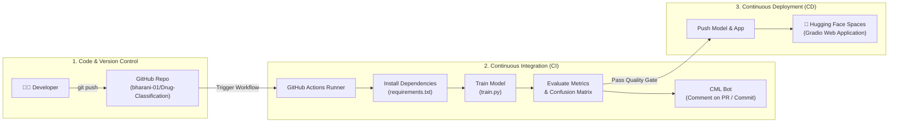

# Drug Classification - CI/CD Pipeline for Machine Learning

[](https://github.com/bharani-01/Drug-Classification/actions)
[](https://www.python.org/)
[](LICENSE)

An automated MLOps pipeline for **Drug Classification** built using Scikit-Learn, GitHub Actions for Continuous Integration (CI), CML (Continuous Machine Learning) for automated metric tracking, and continuous deployment (CD) to Hugging Face Spaces with a Gradio web application.

---

## 🏗️ Representative Block Diagram for CI/CD Pipeline



---

## 📁 Project Directory Structure

```text
Drug-Classification/
├── .github/
│   └── workflows/
│       └── cml.yaml          # GitHub Actions CI/CD workflow configuration
├── App/
│   └── app.py                # Gradio web application for inference
├── Data/
│   └── drug200.csv           # Clinical dataset for drug classification
├── Model/
│   └── drug_pipeline.skops   # Serialized model pipeline artifact
├── Results/
│   ├── metrics.txt           # Generated model evaluation metrics
│   └── model_results.png     # Generated confusion matrix plot
├── Makefile                  # Build and pipeline automation commands
├── requirements.txt          # Python dependencies
├── train.py                  # Model training and evaluation script
├── .gitignore                # Git ignore configuration
└── README.md                 # Project documentation
```

---

## ⚙️ CI/CD Pipeline Workflow Stages

1. **Step 1: GitHub Repository Setup**
   - Host source code, datasets, and automation configurations at [bharani-01/Drug-Classification](https://github.com/bharani-01/Drug-Classification).
2. **Step 2: Hugging Face Spaces Setup**
   - Create a Hugging Face Space running Gradio to host the web application and configure GitHub Actions repository secrets (`HF_TOKEN`).
3. **Step 3: Training & Pipeline Scripting**
   - Preprocess clinical data and train a Random Forest classification pipeline using `train.py`.
4. **Step 4: Continuous Machine Learning (CML)**
   - Run tests on every push, calculate accuracy/F1 scores, plot confusion matrices, and generate automated PR reports.
5. **Step 5: Automated Deployment**
   - Push updated model artifacts and the Gradio app directly to Hugging Face Spaces on successful CI runs.
