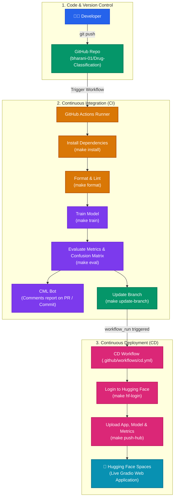

# Drug Classification - CI/CD Pipeline for Machine Learning

[](https://github.com/bharani-01/Drug-Classification/actions)
[](https://www.python.org/)
[](https://gradio.app/)

An automated MLOps pipeline for **Drug Classification** using Scikit-Learn, GitHub Actions for Continuous Integration (CI), CML (Continuous Machine Learning) for automated metric tracking, and Continuous Deployment (CD) to Hugging Face Spaces with a Gradio web application.

---

## 🏗️ Representative Block Diagram for CI/CD Pipeline



---

## 📁 Project Directory Structure

```text
Drug-Classification/
├── .github/
│   └── workflows/
│       ├── ci.yml            # CI workflow: install, format, train, eval, cml, update-branch
│       └── cd.yml            # CD workflow: automated deployment to Hugging Face Spaces
├── app/
│   ├── app.py                # Gradio web application for inference
│   ├── README.md             # Space configuration and metadata
│   └── requirements.txt      # Gradio Space dependencies (scikit-learn, skops, gradio)
├── data/
│   └── drug.csv              # Clinical dataset for drug classification (200 records)
├── model/
│   └── drug_pipeline.skops   # Serialized model pipeline artifact
├── results/
│   ├── metrics.txt           # Generated model evaluation metrics (Accuracy, F1)
│   └── model_results.png     # Generated confusion matrix plot
├── Makefile                  # Build, formatting, training, and deployment commands
├── requirements.txt          # Root Python dependencies for CI & local development
├── train.py                  # Model training and evaluation script
├── .gitignore                # Python ignore patterns
└── README.md                 # Project documentation
```

---

## 🚀 How to Run Locally

### 1. Setup Virtual Environment
```bash
# Windows
py -3.12 -m venv venv
.\venv\Scripts\activate

# Linux / macOS
python3 -m venv venv
source venv/bin/activate
```

### 2. Install Dependencies
```bash
pip install -r requirements.txt
```

### 3. Train & Evaluate Model
```bash
python train.py
```
Outputs:
- Model artifact: `model/drug_pipeline.skops`
- Evaluation metrics: `results/metrics.txt`
- Confusion matrix image: `results/model_results.png`

### 4. Launch Gradio Web App
```bash
pip install -r app/requirements.txt
python app/app.py
```

---

## 🔐 GitHub Actions Repository Secrets

Configure the following secrets in **Settings > Secrets and variables > Actions**:

| Secret Name | Description |
| :--- | :--- |
| `HF` | Hugging Face Access Token with **Write** permission |
| `USER_NAME` | Git commit username for automated update branch pushes |
| `USER_EMAIL` | Git commit email for automated update branch pushes |
| `GITHUB_TOKEN` | Inherent token (grant *Read and write permissions* under *Settings > Actions > General*) |
