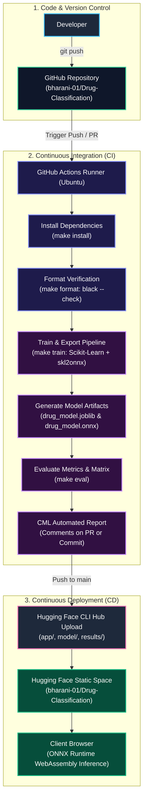

# Drug Classification - MLOps CI/CD Pipeline

[](https://github.com/bharani-01/Drug-Classification/actions)
[](https://www.python.org/)
[](https://onnxruntime.ai/)
[](https://huggingface.co/spaces/bharani-01/Drug-Classification)

An automated end-to-end MLOps pipeline for clinical drug classification. Models are trained using Scikit-Learn, exported to ONNX format, verified via GitHub Actions and Continuous Machine Learning (CML), and continuously deployed to a free **Hugging Face Static Space** with **ONNX Runtime WebAssembly** for zero-latency, serverless in-browser inference.

---

## Architecture Flow



---

## Project Directory Structure

```text
Drug-Classification/
├── .github/
│   └── workflows/
│       ├── ci.yml            # Automated CI/CD: install, format, train, eval, CML report, HF deploy
│       └── cd.yml            # Manual dispatch workflow for Hugging Face deployment
├── app/
│   ├── index.html            # Static single-page application with ONNX Runtime Web
│   └── README.md             # Hugging Face Space metadata (sdk: static)
├── data/
│   ├── drug.csv              # Clinical patient dataset (200 records)
│   └── drug200.csv           # Dataset alias
├── model/
│   ├── drug_model.joblib     # Python Scikit-Learn pipeline checkpoint
│   └── drug_model.onnx       # Portable ONNX model for browser inference
├── results/
│   ├── confusion_matrix.png  # Confusion matrix evaluation plot
│   ├── metrics.txt           # Accuracy, F1-score, and classification report
│   └── model_results.png     # Evaluation plot alias
├── train.py                  # Training, evaluation, and ONNX export script
├── requirements.txt          # Python dependencies for CI runner and training
├── Makefile                  # Build and task automation targets
└── README.md                 # Project documentation
```

---

## Key Features

1. **Serverless Browser Inference:**
   - Inference runs completely in the client browser using WebAssembly (`onnxruntime-web`).
   - No Python server or GPU instance needed on Hugging Face Spaces (runs on 100% free Static HTML Spaces).
2. **Automated MLOps Pipeline:**
   - Every push to `main` verifies Python code formatting with `black --check`.
   - Automatically trains the Random Forest model and exports the ONNX graph with categorical encoders baked in.
   - Generates confusion matrix and performance metrics.
   - CML creates an evaluation summary directly in GitHub pull requests or commit comments.
3. **Continuous Deployment:**
   - Successfully validated models and static web files are synchronized directly to Hugging Face Spaces using the official `hf` CLI.

---

## Quickstart & Local Development

### 1. Setup Environment
```bash
python -m venv venv
source venv/bin/activate       # On Linux/macOS
# or: .\venv\Scripts\activate   # On Windows

make install
```

### 2. Format & Lint
```bash
make format
```

### 3. Train Model & Export ONNX
```bash
make train
```
This produces:
- `model/drug_model.joblib`
- `model/drug_model.onnx`
- `results/metrics.txt`
- `results/confusion_matrix.png`

### 4. Evaluate Performance
```bash
make eval
```

### 5. Local Web Preview
To test the static web interface locally:
```bash
# Start a simple HTTP server from the repository root:
python -m http.server 8000
```
Open [http://localhost:8000/app/index.html](http://localhost:8000/app/index.html) in your browser.

---

## GitHub Secrets Configuration

To enable automated deployment to your Hugging Face Space, configure these repository secrets in **GitHub -> Settings -> Secrets and variables -> Actions**:

| Secret Name | Description | Example |
| :--- | :--- | :--- |
| `HF_TOKEN` | Hugging Face access token with **Write** permissions | `hf_...` |
| `HF_SPACE_ID` | Your Hugging Face Space identifier | `bharani-01/Drug-Classification` |

---

## Verification & Parity Test

Validate that local Scikit-Learn predictions match the ONNX model predictions exactly:

```python
import joblib
import numpy as np
import onnxruntime as rt
import pandas as pd

sample = pd.DataFrame([{
    "Age": 30, "Sex": "F", "BP": "NORMAL",
    "Cholesterol": "NORMAL", "Na_to_K": 15.0,
}])

# 1. Scikit-Learn Pipeline
model = joblib.load("model/drug_model.joblib")
print("Scikit-Learn:", model.predict(sample)[0], model.predict_proba(sample)[0])

# 2. ONNX Runtime
sess = rt.InferenceSession("model/drug_model.onnx")
feeds = {
    "Age": np.array([[30]], dtype=np.int64),
    "Sex": np.array([["F"]], dtype=object),
    "BP": np.array([["NORMAL"]], dtype=object),
    "Cholesterol": np.array([["NORMAL"]], dtype=object),
    "Na_to_K": np.array([[15.0]], dtype=np.float64),
}
label, probs = sess.run(None, feeds)
print("ONNX Runtime:", label[0], probs)
```

---

## Disclaimer
This project is an educational demonstration of MLOps CI/CD and in-browser ONNX inference. It is not intended for clinical diagnostic use or prescribing medication.
